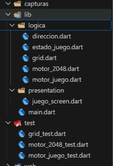
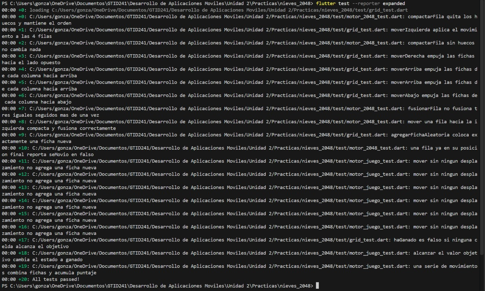
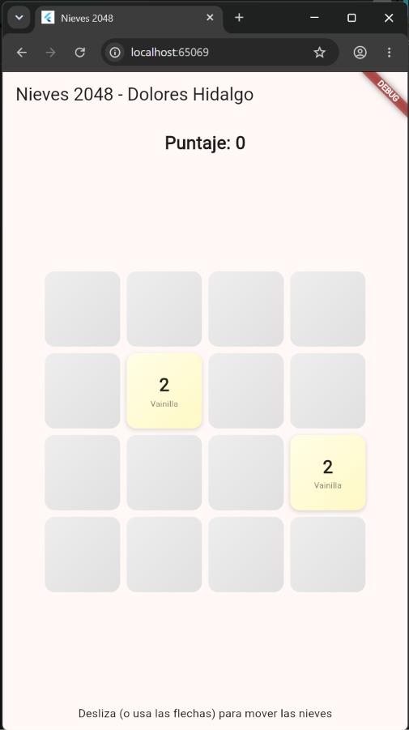
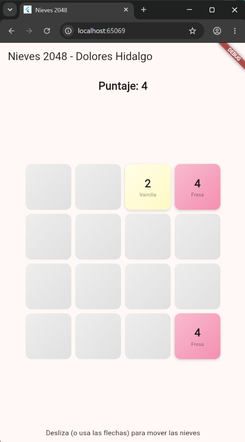
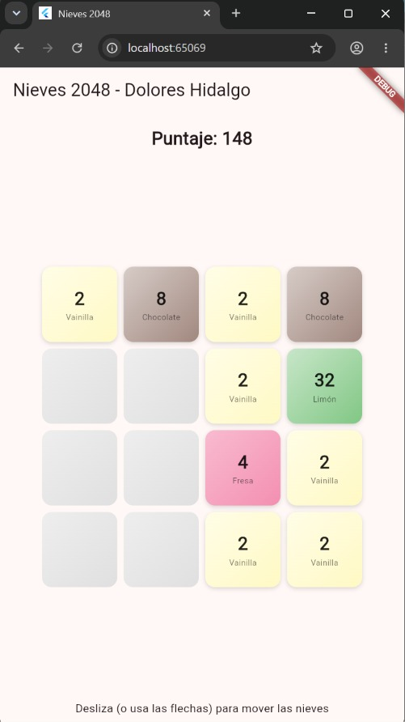
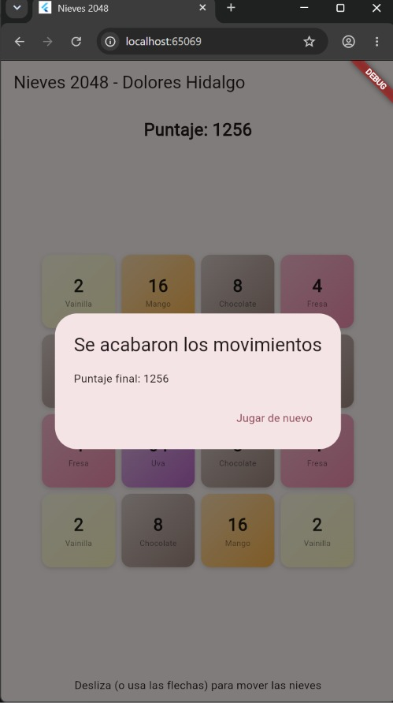
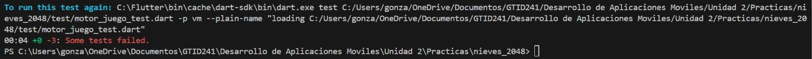

# Nieves 2048 · Flutter con TDD

**Materia:** Desarrollo Móvil Integral
**Alumno:** González López Yael Isaac
**Fecha:** 30 de octubre de 2026

## Descripción

Clon del juego 2048 donde cada valor es un sabor de nieve de Dolores Hidalgo (2 = Vainilla, 128 = Mole, 2048 = ¡Independencia!). El algoritmo (compactar, fusionar, mover en 4 direcciones, detectar victoria y derrota) se desarrolló con TDD y vive en Dart puro. La pantalla con degradados y animaciones va encima de reglas ya probadas.

## Estructura del proyecto

### Todas las pruebas en verde (20)

## Evidencia de la aplicación

### Pantalla inicial

### Fichas fusionadas con su sabor

### Tablero avanzado con varios sabores

### Fin del juego

## Prueba en Rojo

